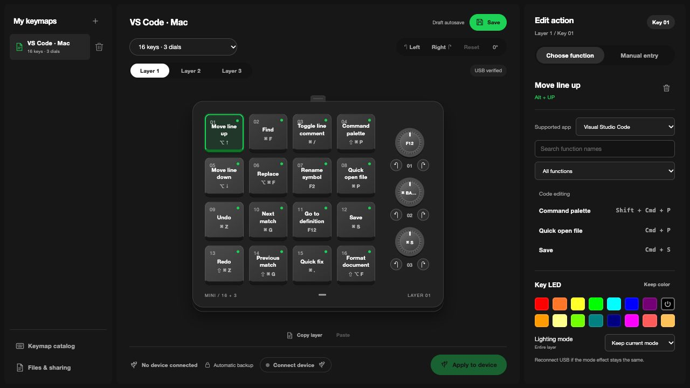
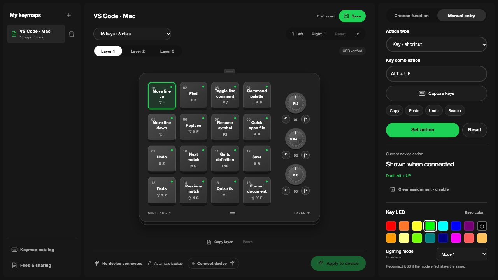

# Mini Keyboard Studio

[English](README.md) · [한국어](README.ko.md) · [日本語](README.ja.md) · [Español](README.es.md) · [简体中文](README.zh-CN.md) · [繁體中文](README.zh-TW.md)

Make a small keyboard your own. Mini Keyboard Studio is a local macOS app for editing keys, dials and lighting, then applying your keymap over USB.

**[Download for macOS Apple Silicon](https://github.com/kyungtaek/mini-keyboard-studio/releases/latest)** · [Development guide](docs/development.md)

Available in English, Korean, Japanese, Spanish, Simplified Chinese and Traditional Chinese. Change the language from **Files & sharing** or the app menu.

## What you can do

- **Build three layers.** Assign keys, modifier combinations, macros, media controls and mouse actions to keys and dials.
- **Find useful shortcuts.** Browse references for VS Code, Codex, Claude, system controls, Forza Horizon 4 and Modern Warfare 4. Keep a readable function name on each assignment.
- **Choose your orientation.** Rotate the layout to match how the keyboard sits on your desk.
- **Set key lighting.** Choose from 15 colors plus **Off**, with a shared LED mode for each layer.
- **Keep and share keymaps.** Save locally, import or export JSON, and share a link containing the profile. Editing and local files work offline.
- **Apply with feedback.** Back up key assignments before writing, verify stored values by reading them back, and inspect key input with built-in diagnostics.
- **Stay in the menu bar.** Close the window and reopen the editor from the menu bar when needed.

## Get started

1. Download the Apple Silicon DMG from [Releases](https://github.com/kyungtaek/mini-keyboard-studio/releases/latest), move the app to **Applications**, and open it.
2. Connect the keyboard with a USB data cable and choose **Connect keyboard**.
3. Start with a built-in sample or a new keymap. Select a key or dial, assign a function, and optionally set key colors and the layer LED mode.
4. Save your keymap and choose **Apply to device** when ready. Opening a file or changing the selected app reference does not apply it automatically.

The optional GitHub keymap catalog uses GitHub authentication. Built-in samples and local keymaps do not require a GitHub account. Game shortcuts are suggested bindings; match them to your in-game settings.

## Device support

The current verified device is the **16-key, 3-dial Mini Keyboard**, USB **514C:8850**, with the tested firmware. Other model layouts are available as candidates; they have not all been tested on physical hardware.

LED modes are shown as **0–5** because their visual effects are not all verified. A mode change may need a USB reconnect to become visible; some color changes have been observed to update live. A successful readback confirms stored values, not every visible effect. Applying a keymap is manual; the app does not switch keymaps based on the focused application.
